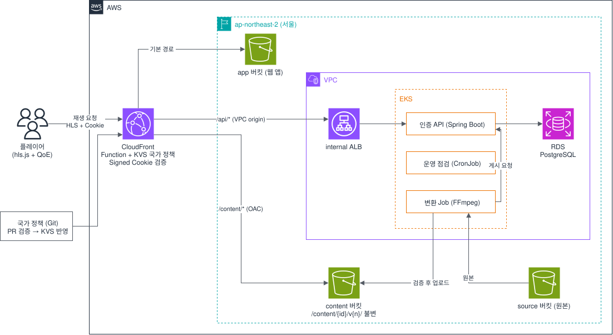

# OTT

국가마다 볼 수 있는 콘텐츠가 다른 VOD 서비스를 AWS에서 만들고, 운영할 때 생기는 문제를 실험으로 확인하는 1인 프로젝트.

지금은 로컬 개발 단계다. AWS 배포와 실험은 개발을 다 끝낸 뒤에 필요한 기간만 리소스를 만들어서 하고 바로 철거한다.

## 왜 만들었나

이전 프로젝트 FlowTicket에서는 동시 요청이 몰리는 서비스를 EKS에서 HPA와 Cluster Autoscaler로 늘리고, 부하 테스트로 확인했다. 그건 한 리전 안에서 한 종류의 서버를 늘리고 줄이는 문제였다. 이번에는 거기서 다루지 못한 두 가지를 골랐다.

첫째는 서버 바깥에서 일어나는 일이다. 사용자는 여러 나라에 있고, 영상 요청 대부분은 서버까지 오지 않고 CDN에서 끝난다. 이 상태에서 국가마다 볼 수 있는 콘텐츠를 다르게 하려면 판단을 엣지에서 해야 한다. 그러면 캐시 효율은 지킬 수 있는지, 정책을 바꾸면 언제 반영되는지, 잘못 바꿨을 때 어떻게 되돌리는지가 새로운 문제가 된다.

둘째는 성격이 다른 작업을 한 플랫폼에서 같이 운영하는 일이다. 항상 응답해야 하는 API와, CPU를 많이 쓰고 중간에 죽을 수도 있는 영상 변환 배치를 같은 쿠버네티스에서 돌린다. 이때 변환이 API를 느리게 만들지 않는지, 변환이 실패하거나 늦게 끝나도 잘못된 영상이 공개되지 않는지를 확인하고 싶었다.

OTT를 고른 건 이 두 문제가 한 서비스에서 같이 나오기 때문이다. 판권 때문에 국가마다 볼 수 있는 콘텐츠가 다르고, 새 영상이 들어올 때마다 여러 화질로 변환하는 작업이 돈다.

EKS는 OTT라서 꼭 필요한 게 아니다. API 하나만 보면 ECS가 더 단순하다. 지원하려는 플랫폼·DevOps 직무에서 쿠버네티스 운영 비중이 커서 일부러 골랐고, 그 판단과 대안은 [ADR-0011](docs/adr/0011-eks-platform.md)에 남겼다.

## 구조

계획된 구성이다. 아직 배포하지 않았다. 그림 파일은 draw.io에서 그대로 열어 고칠 수 있고, 자세한 흐름과 근거는 [docs/design.md](docs/design.md) §3.

## 핵심 결정

| 결정 | 이유 | 대가 |
|---|---|---|
| 변환 결과는 `/content/{id}/v{n}/`에 쓰고 덮어쓰지 않는다. 공개 버전은 DB 포인터로 바꾼다 | 캐시 무효화 없이 버전을 바꿀 수 있고, 실패한 변환이 공개 중인 영상을 건드릴 수 없다. S3 버킷 정책에도 덮어쓰기 거부 조건을 넣었다 | 버전마다 저장 공간이 들고, 안 쓰는 버전을 정리하는 작업이 따로 필요하다 |
| 국가 판정은 CloudFront Function + KVS에서 하고, 국가는 캐시 키에 넣지 않는다 | 국가마다 캐시가 갈라지지 않는다 | 정책을 바꾸면 엣지 반영까지 지연이 생긴다. 얼마나 걸리는지 측정하는 게 실험 E5 |
| 게시는 DB 행 잠금 안에서 세대 번호(`publish_epoch`)와 최고 게시 버전을 함께 검사한다 | 늦게 끝난 옛 버전이나 롤백 전에 시작한 작업이 롤백을 덮지 못한다 | 롤백은 운영자 전용 동작으로 따로 둬야 한다 |
| 쿠키는 공개 버전 경로 단위로 발급한다 | 쿠키 하나로 다른 콘텐츠나 공개 전 버전을 받을 수 없다 | 버전이 바뀌면 쿠키를 다시 받아야 한다 |
| 규칙은 문서가 아니라 검사로 강제한다 (ArchUnit, ESLint, Ruff, tflint, trivy, CI) | 규칙을 적어만 두면 지켜지지 않는다. 일부러 어긴 코드로 실제로 막히는지 확인했다 ([기록](docs/harness-verification.md)) | 검사 도구 버전을 맞추고 관리하는 일이 생긴다 |

결정마다의 배경은 [docs/adr](docs/adr/)와 설계 문서에 있다.

## 실험 계획

아직 측정 전이다. 수치는 측정한 뒤에만 여기에 적는다.

| 실험 | 확인하려는 것 |
|---|---|
| E1 | 재생 시작 지연이 거리 때문인지 회선 품질 때문인지 (서울·자카르타·미국) |
| E2 | 캐시가 비었을 때와 찼을 때 재생 시작 시간 차이 |
| E4 | API Pod 하나가 죽을 때 재생 권한 발급이 끊기는지 (AZ 장애는 범위 밖) |
| E5 | 국가 정책을 바꾸면 각 국가의 요청에 반영되기까지 걸리는 시간 |
| E6 | 잘못 배포한 정책을 얼마나 빨리 감지하고 되돌리는지 |
| E7 | 변환 작업이 API 응답 시간에 영향을 주는지. 영향이 안 보이면 격리 효과를 주장하지 않는다 |
| E8, E9 | 변환 작업이 몰릴 때 노드가 늘고 주는지, 변환 중 노드가 내려가면 어떻게 되는지 |

전체 목록과 측정 방법은 [docs/design.md](docs/design.md) §10.

## 트러블슈팅

개발하면서 실제로 겪은 것들.

| 문제 | 원인 | 조치 |
|---|---|---|
| 업로드 스크립트가 segment 업로드에 실패해도 master playlist까지 올림 | 파일별 실패를 출력만 하고 마지막에 개수만 셌다. 빠진 segment를 참조하는 버전이 재생 가능해질 수 있었다 | 앞 단계가 하나라도 실패하면 다음 단계를 올리지 않게 바꾸고, 실패를 주입하는 테스트로 재현·확인 ([#2](https://github.com/gumwoo/OTT/pull/2)) |
| API가 로컬 DB에 붙을 때 비밀번호 인증 실패 | 오류 메시지가 한국어로 나와서 컨테이너가 아니라 Windows에 직접 설치된 PostgreSQL 18이 5432를 쓰고 있다는 걸 알았다 | compose 쪽 포트를 5434로 옮김 |
| CI에서 `terraform init`이 provider 체크섬 불일치로 실패 | lock 파일을 Windows에서 만들어 Windows 해시만 들어 있었다 | `terraform providers lock`으로 linux·darwin 해시 추가 |
| 보안 검사 도구(trivy) 도입 중 공급망 침해 공지 발견 | 2026-03 trivy와 trivy-action 배포물이 침해된 적이 있고, 0.72 미만에 경로 조작 취약점이 공지됨 | action 대신 최신 이미지를 digest로 고정해서 실행 |

## 기술

| 영역 | 사용 |
|---|---|
| API | Spring Boot 4.1, Spring Security 7.1, JPA, Flyway, PostgreSQL 17 |
| 웹 | React 19, React Router 8, TanStack Query 5, Vite 8, Tailwind 4 |
| 변환 | Python 3.13, FFmpeg |
| 인프라 | AWS (CloudFront, S3, EKS, RDS), Terraform. Helm·Argo CD는 쿠버네티스 단계에서 추가 |
| 검사 | GitHub Actions, ArchUnit, Checkstyle, ESLint, Ruff, mypy, tflint, trivy, CodeQL |

## 문서

- [설계](docs/design.md), [앱 설계](docs/app-design.md), [ADR](docs/adr/)
- [개발 규칙](docs/CONVENTIONS.md), [하네스 검증 기록](docs/harness-verification.md), [UI 규칙](docs/ui.md)
- [개발 환경과 로컬 실행](docs/development.md)
